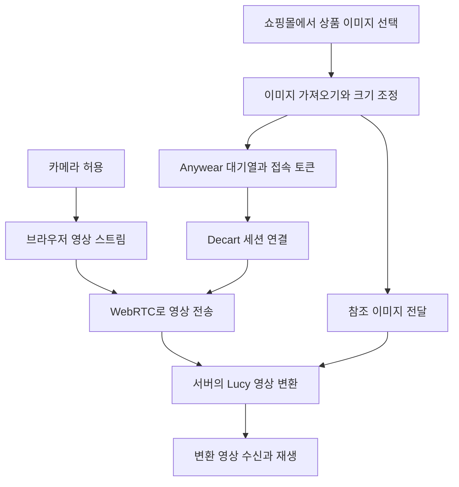

# Anywear의 동작 원리와 확장 가능성

## 가장 궁금한 세 가지

| 질문 | 답 |
| --- | --- |
| 크롬 확장 프로그램만으로 어떻게 이런 영상이 나오나? | 확장 프로그램이 카메라 영상을 서버에 보내고, 서버의 Lucy 영상 AI가 변환한 영상을 실시간으로 돌려준다. |
| 무료라면 자원을 별로 안 쓰는 것 아닌가? | 사용자에게 받는 요금과 서버 연산량은 별개다. 공개 API에는 사용 시간에 따른 요금이 있다. |
| 옷 대신 얼굴이나 다른 것을 바꿀 수 있나? | 가능하다. 의류 전용 모델과 별도로 범용 Lucy 모델이 인물·헤어·배경·물체 변환을 지원한다. |

## 화면 뒤에서 일어나는 일

확장 프로그램은 쇼핑몰 페이지에 위젯을 넣고 드래그한 상품 이미지를 받는다. 이미지 주소로 직접 가져오기를 시도하고, 실패하면 Anywear의 이미지 프록시를 사용한다. 이미지는 브라우저에서 크기와 형식을 조정한 뒤 참조 이미지로 전달한다.

접속할 때는 Anywear의 대기열에서 차례를 기다린다. 서버가 접속을 허용하면 API 접속 토큰을 받고 Decart SDK로 연결한다. 토큰을 직접 요청하는 별도 경로도 있다.

영상 전송과 제어 통신은 나뉜다. WebSocket은 세션 연결과 이미지·프롬프트 같은 제어 정보를 다루고, LiveKit을 사용하는 WebRTC 경로는 영상 트랙을 다룬다. 브라우저가 받은 원격 영상 스트림을 화면의 결과 영상에 연결한다. 상품을 바꿀 때는 같은 세션에 새 참조 이미지를 보낼 수 있다.

배포 코드의 기본 모델 이름은 `lucy-vton-3.5`다. 다만 서버가 내려주는 `modelName`으로 바꿀 수 있어 실제 모든 접속이 이 모델을 사용한다고 확정할 수는 없다. 공개 문서의 `lucy-vton-latest`는 현재 3.6을 가리킨다.

브라우저의 처리에는 카메라 캡처, 영상 인코딩·디코딩, 캔버스 변환, 화면 재생이 포함된다. 따라서 사용자 PC의 부하도 0은 아니다. 큰 영상 생성 연산은 원격 모델이 담당하는 구조다.

## 옆으로 돌아도 옷이 따라오는 이유

입력 카메라가 계속 움직이는 영상을 보내므로 모델도 달라지는 자세를 반영한 영상을 계속 만든다. 상품 사진을 몸 위에 고정해서 붙이는 방식으로는 표현하기 어려운 가림, 주름, 자세 변화를 생성 모델이 채워 넣는 것이다.

여기에는 중요한 한계가 있다. 앞면 사진 한 장에 없는 뒷면, 실제 소재의 물성, 정확한 치수는 AI가 추정할 수밖에 없다. 자연스러워 보이는 영상이 나와도 실제 사이즈나 착용감을 보증하지 않는다. 판매사의 “물리적으로 자연스러운 움직임”이라는 설명도 정밀한 옷감 시뮬레이션이나 치수 측정이 입증됐다는 뜻으로 읽어서는 안 된다.

실시간 모델과 저지연 영상 통신을 함께 써야 이런 경험이 가능하다. WebRTC는 전송 수단이고 영상 생성은 모델의 역할이다. 몇 FPS를 지원한다는 수치와 카메라에서 화면까지의 지연 시간도 서로 다르다. 실제 지연은 네트워크·인코딩·서버 처리·디코딩이 합쳐진 값이다.

모델의 세부 신경망 구조, 학습 방식, 가중치, GPU 배치와 최적화는 이 확장 프로그램에서 복원할 수 없다. 공개된 동작과 클라이언트 코드만으로 특정 증류 방식이나 GPU 수를 단정할 근거도 없다.

## 무료인데 비용은 누가 내나?

Anywear의 공개 페이지는 베타 기간 무료 이용을 안내한다. 외부 개발자에게 제공하는 Lucy 2.5와 Lucy VTON API는 일반 모드에서 **실제 생성 시간 초당 $0.02**, 빠른 모드에서는 **초당 $0.04**다.

| 실제 생성 시간과 이용량 | 일반 모드 | 빠른 모드 |
| --- | ---: | ---: |
| 30초 × 1회 | $0.60 | $1.20 |
| 1분 × 1회 | $1.20 | $2.40 |
| 8분 × 1회 | $9.60 | $19.20 |
| 1분 × 하루 1,000회 | $1,200.00/일 | $2,400.00/일 |

이는 공개 API 요금으로 계산한 **재구현 비용의 참고치**다. Anywear 운영사가 실제로 지출하는 GPU 원가나 내부 정산액이 아니다. 저장·전송·일반 서버·운영 비용도 이 표에 더하지 않았다. 대기열에서 기다린 시간을 생성 시간으로 넣은 계산도 아니다.

무료 체험을 제공하는 동안에도 운영사는 연산 자원을 부담한다. 모델 제공사가 직접 만든 제품이므로 외부 API 가격과 내부 원가는 다를 수 있다. 베타 홍보나 고객 확보를 위해 비용을 부담한다는 해석은 가능하지만, 지원 예산과 정확한 수익 구조는 공개되지 않았다.

대기열 코드는 동시에 처리할 수 있는 접속 수를 관리한다. 따라서 긴 대기 시간은 무료 이용이 계산을 거의 쓰지 않는다는 근거가 되지 않는다. 배포물에 포함된 개발 메모도 앱의 대기열과 Decart의 동시 세션 한도가 별개임을 설명한다. 그 메모의 특정 접속 수를 현재 전 세계 사용자 한도나 GPU 개수로 해석하면 안 된다.

또한 배포 코드에는 무료 체험 잔여 횟수, 구독 요구, 이용량 집계와 결제 화면을 다루는 경로가 있다. 공개 페이지의 무료 안내와 이 코드가 공존하므로, “앞으로도 누구에게나 무제한 무료”라고 단정할 수 없다. 현재 계정에 적용되는 요금·한도는 미확인이다.

## 얼굴이나 다른 것에는 어디까지 쓸 수 있나?

| 만들고 싶은 기능 | 우선 비교할 기술 | 기대할 수 있는 것과 한계 |
| --- | --- | --- |
| 실시간 의상 교체 | Lucy VTON | 옷 참조 이미지를 반영한 영상. 실제 핏과 치수 보장은 별도 문제다. |
| 얼굴을 캐릭터나 다른 외형으로 변환 | Lucy 2.5 | 참조 이미지와 문장으로 인물을 바꾸는 기능. 얼굴만 정확히 교체하거나 신원을 완벽하게 유지하는 품질은 따로 검증해야 한다. |
| 머리색·헤어스타일 변경 | Lucy 2.5 | 머리색 변경과 헤어 참조 응용. 얼굴·귀·손 주변의 경계가 흔들릴 수 있다. |
| 배경·실내 물체 변경 | Lucy 2.5 | 장면과 물체 교체. 가림·그림자·반사의 정확도는 별도 확인이 필요하다. |
| 안경·메이크업·얼굴에 붙는 효과 | MediaPipe + 브라우저 렌더링 | 얼굴 위치와 표정을 추적해 효과를 배치하는 로컬 설계. 새 실사 얼굴을 생성하는 기능까지 제공하지는 않는다. |

“옷을 할 수 있다면 얼굴도 가능할 것 같다”는 방향은 맞다. 확장 프로그램의 카메라 입력과 결과 영상 재생 구조는 재사용하고, 바꿀 대상에 맞춰 모델·참조 이미지·프롬프트를 선택하면 된다. 다만 의류 전용 모델에 얼굴 사진을 넣기만 하면 원하는 얼굴 변환이 된다고 보장할 수는 없다.

완전히 무료에 가까운 서버 운영을 원한다면 범위를 좁히는 편이 현실적이다. 얼굴 추적과 안경 합성처럼 기기에서 처리할 수 있는 효과를 먼저 비교할 수 있다. 실사 얼굴·전신·장면을 계속 새로 생성하는 기능에는 같은 가정을 적용하기 어렵다.

## 재구현할 때의 첫 선택

실사 변환이 목표라면 **공식 API를 쓰는 작은 웹앱으로 얼굴·헤어·배경 중 하나를 먼저 검증하고, 이후 확장 프로그램으로 옮기는 경로**가 적합하다. 처음부터 모델을 직접 학습하거나 원본 확장 프로그램 코드를 복제할 필요는 없다. 결과 품질, 실제 생성 초당 비용, 중단할 때 과금이 끝나는지를 먼저 판단할 수 있다.

서버 연산 비용을 줄이는 것이 더 중요하고 기능이 안경·색조 효과 정도라면 MediaPipe 기반 로컬 경로부터 비교하는 편이 낫다. 두 경우 모두 사용자 얼굴과 상품 이미지를 처리하므로 외부 전송·보관·이용권은 설계에 포함해야 한다.

## 아직 알 수 없는 것

- 실제 사용 세션의 화면 품질, 얼굴 보존 정도, 종단 지연과 장시간 안정성.
- 세션마다 서버가 선택하는 모델과 현재 계정별 무료·유료 조건.
- 모델의 가중치, 서버 내부 구성, GPU 종류·개수와 운영사의 내부 원가.
- Anywear의 서비스별 영상 보관 기간과 학습 제외 조건. “사진 업로드가 필요 없다”는 안내만으로 카메라 영상이 기기 밖으로 나가지 않거나 저장·학습에 쓰이지 않는다고 단정할 수 없다.
