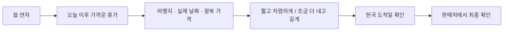

# 틈 — 쉬는 날부터 여행까지

**사용자가 원하는 것: 남은 연차로 언제, 어디에, 며칠, 얼마에 다녀올 수 있는지 바로 고른다.**

| 사용자 | 필요한 배려 |
|---|---|
| 주 사용자: 주 5일 근무 직장인 | 휴가 신청할 날짜와 실제 여행 날짜를 함께 본다. |
| 취약 사용자: 작은 화면에서 짧게 탐색하는 사람, 날짜·가격 구분이 어려운 사람 | 한 방향으로 진행하고, 숨겨진 가로 스크롤과 작은 보조 글자를 줄인다. |
| 도착 직전: 떠나고 싶지만 연차 낭비와 복귀 실패가 걱정됨 | 가능한 선택지를 먼저 보여 주고, 확인되지 않은 도착 시각은 숨기지 않는다. |

**도착 감정: 기대와 불안을 함께 안고, 휴가를 망치지 않을 싼 여행을 빠르게 찾고 싶다.**

| 해야 할 일 | 바라는 결과 |
|---|---|
| 기능 | 연차를 정해야 하는 상황에서, 오늘 이후 가능한 일정별 여행지와 운임을 비교하고 싶다. 그래서 휴가 신청과 여행 후보 선택을 함께 끝낼 수 있게. |
| 감정 | 날짜를 잘못 골랐다는 불안 없이 스스로 판단한다. |
| 사회 | 동료·동행자에게 휴가 날짜와 비용을 간단히 전달한다. |

| 바꿀 것 | 화면의 기준 |
|---|---|
| 첫 선택 | 현재 연도·가까운 날짜가 기본. 과거 일정은 숨기고 연도는 보조 조건으로 둔다. |
| 모바일 비교 | 일정 2개 이상을 쉽게 훑는다. 선택 후 목적지를 찾으려고 긴 설명을 다시 지나가지 않는다. |
| 가격 판단 | 실제 출발·귀국편 날짜, 숙박 수, 필요 연차, 성인 1인 왕복 가격을 한 묶음으로 표시한다. |
| 상세 행동 | 가격·판매처가 먼저. 과거 가격과 노선 평균 할인율은 핵심 흐름에서 뺀다. |
| 복귀 판단 | `한국 도착 시각 미확인`을 판매처 행동 가까이에 한 번 표시한다. 출근 가능을 보장하지 않는다. |

| 상태 | 사용자가 할 수 있어야 하는 일 |
|---|---|
| 조회 중 | 조건과 선택한 날짜를 유지하고, 완료된 가격부터 비교한다. |
| 항공권 없음 | 날짜·최소 숙박 조건을 바로 바꾼다. |
| 일부 실패 | 확인된 가격은 유지하고, 실패한 조회만 다시 시도한다. |
| 저장한 가격 변경·소실 | 현재 운임을 다시 보고 다른 후보로 이동한다. |

| 아이콘만 사용 가능 | 글자를 유지할 것 |
|---|---|
| 닫기 · 저장 · 공유 · 새로고침 · 도움말 | 연차 · 날짜 · 왕복 가격 · 한국 도착 미확인 · 판매처 보기 |

아이콘 버튼에는 접근성 이름과 충분한 터치 영역을 둔다. 색·그림만으로 선택과 오류를 구분하지 않는다. 장식 이미지가 가격과 행동을 밀어내지 않게 한다.

| 다크패턴 7종 | 판정 · 위치 |
|---|---|
| 강제 연속성 | 없음. 구독·체험·자동 결제 없음. |
| 확인 샤밍 | 없음. 저장 취소·오류 문구에 비난 없음. |
| 숨은 비용 | 주의. 운임에 수하물·최종 결제 조건이 미확인. 판매처 행동 옆에 그 조건을 표시한다. |
| 가짜 긴박성 | 없음. 좌석 부족·카운트다운 없음. |
| 몰래 가입 | 없음. 회원가입·기본 동의 없음. |
| 혼동 인터페이스 | 주의. 휴가 최대 일수와 실제 여행 일수가 섞이고 가로 일정 탐색이 숨겨짐. 단위와 탐색 방향을 정리한다. |
| 과도한 수집 | 없음. 계정·여권·연락처 입력 없음. 저장은 브라우저에 한정. |

| 존엄성 | 판정 · 조치 |
|---|---|
| 창피하게 하지 않는가 | YES. 실패와 저장 취소를 중립적으로 쓴다. |
| 조작당하지 않는가 | 조건부 YES. 노선 평균 대비 하락률을 같은 항공편 할인처럼 보이게 하지 않는다. |
| 길을 잃지 않는가 | NO. 모바일 일정·선택 요약·조건·목적지의 중복 단계를 줄인다. |
| 실패 상태에서도 인간적인가 | YES. 선택을 보존하고 복구 행동을 제공한다. |

| 수요 확인 | 판정 |
|---|---|
| Mom Test | 부분 충족. 요청자의 실제 우선순위는 일정·연차·저렴한 운임이다. 다른 사용자 행동은 아직 확인하지 않았다. |
| Hair-on-Fire | 미확인. 반복적으로 급한 문제라는 근거는 없다. |
| Would They Pay | 미확인. 결제 의향·실제 결제 근거는 없다. |

**미해결: 정확한 한국 도착 시각이 없으면 출근 가능한 여행인지 확정할 수 없다. 일반 사용자에게 공개 제공할 데이터 권한도 필요하다.**
